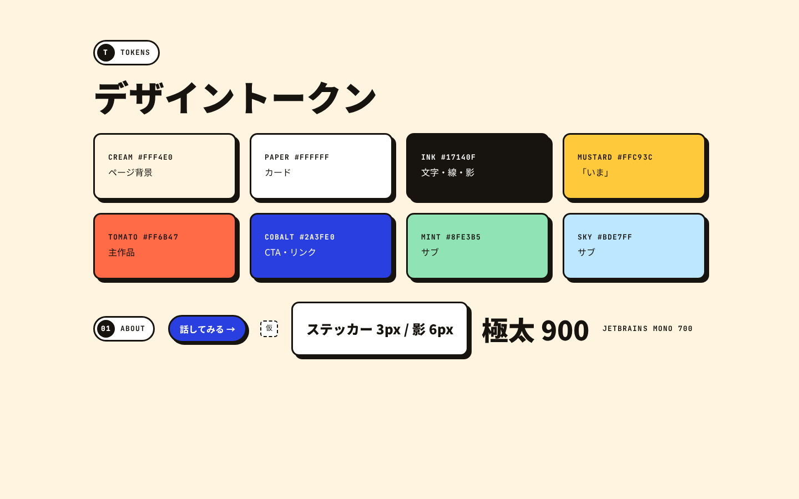
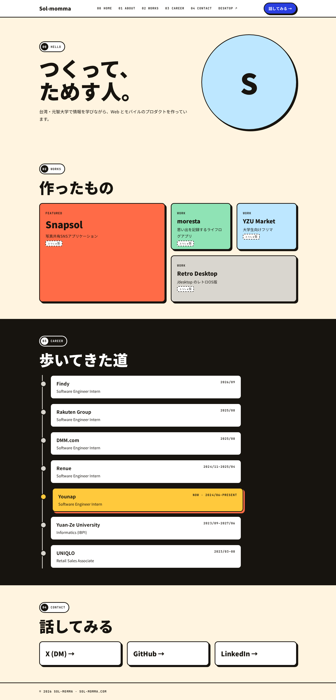
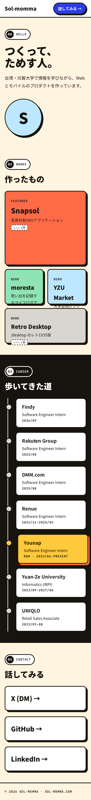

# 0001: DevFest Hack 風デザインへの刷新案

- ステータス: **Draft**（採用するかは壮宇さんが決める）
- 作成: 2026-10-15 / Hawkeye
- Thor: 8df3b564-4c4b-4ff7-8fd3-11e8c3748512

## 背景と目的

- 背景
  - 壮宇さんが [DevFest Hack 2026](https://df-hack26.gdgs.jp/#schedule) の UI を気に入った
  - 同じスタイルの名刺ページ hello.sol-momma.com（`Sol-momma/binary-sunset`）がもうできている
  - sol-momma.com（tatooine）はブログテンプレート寄りの見た目で、名刺ページとトーンがそろっていない
- 目的
  - tatooine のトップ・About に同じデザイン言語を入れ、2つのサイトの印象をそろえる

## ゴール

- トップを「番号つきセクション＋ベントー＋縦タイムライン」の1ページ構成にする
- binary-sunset とデザイントークン（色・線・影・文字）をそろえる
- `/desktop`（レトロOS版）はそのまま残し、入口をヘッダーに置く

## ノンゴール

- `/desktop` の見た目は変えない（OS の外枠 2px ／中身 3px の線の使い分けだけ合わせる）
- `/private`（#25、Cloudflare Access）・デプロイ設定・DNS には触れない
- CMS の導入、英語版の作成

## UI

- トークン: 
- トップ 1440px: 
- トップ 390px: 
- 構成
  - ヘッダー: ロゴ／番号つきナビ（00–04 ＋ Desktop ↗）／「話してみる →」
    - 390px ではナビを隠し、ロゴと CTA だけにする
  - 00 HELLO: 極太見出し「つくって、ためす人。」＋アバター（素材が届くまで図形で仮置き）
  - 02 WORKS: ベントー 4列（390px では2列）
    - Snapsol を 2×2 の主作品（Tomato）にする
    - moresta／YZU Market／Retro Desktop（/desktop への導線）
  - 03 CAREER: 黒い帯に縦タイムライン
    - 「いま」は1件だけ Mustard ＋ Tomato の影で強調（モックでは Younap）
  - 04 CONTACT: X（DM）／GitHub／LinkedIn の3つ

## 設計

- トークン
  - binary-sunset と同じ値を `src/styles/global.css` の `@theme` に入れる（cream / paper / ink / mustard / tomato / cobalt / mint / sky / platinum / muted）
  - 線 3px・角丸 14px・影 `6px 6px 0 ink`。強調色は1画面に1か所
- フォント
  - Noto Sans JP（900/400）＋ JetBrains Mono（700）を自己ホストする（どちらも OFL）
  - 今の Atkinson はやめる
- コンポーネント（Astro。島が要らないものは Preact を使わない）
  - `SectionPill.astro`（番号＋英ラベル）、`StickerCard.astro`、`BentoGrid.astro`、`CareerTimeline.astro`（`TimelineItem` を置き換える）
- データ
  - 既存の Content Collections（`experience` / `works`）をそのまま使う
  - `experience` に `current: boolean`（任意）を足して「いま」を決める
  - `works` に `featured` と `accent` を足す
- ページ
  - `index.astro` を1ページ構成にし、`about.astro` は `/#career` へ寄せる（消すかどうかは未決）
  - `KamishibaiBackground`（Three.js）はヒーローの背景に残すか未決（下の未決事項を参照）

## 検討した別案

- A. binary-sunset に統合して tatooine をリダイレクトする
  - 長所: 保守するサイトが1つになる
  - 短所: `/desktop`・ブログの資産を移す手間が大きく、URL も変わる
- B. トークンだけ入れて、レイアウトは今のまま
  - 長所: 差分が小さく安全
  - 短所: ベントー・タイムラインといった「よさ」の中心が入らない
- C. 本案（トップ・About を作り直し、/desktop は残す）
  - 長所: 2つのサイトの印象がそろう。既存のデータをそのまま使える
  - 短所: 見た目の差分が大きく、PR が数本になる

## 横断的な懸念

- アクセシビリティ: 白文字は Ink と Cobalt の上だけ（AA）。フォーカス表示と `prefers-reduced-motion` に対応する
- 性能: Noto Sans JP はサブセット化が必須。Three.js の背景を残すなら遅延読み込みにする
- ライセンス: df-hack の素材・Apple 系フォント・ryOS コード（AGPL）は使わない
- 保守: binary-sunset とトークンが二重管理になる（当面はコピー、将来は共有パッケージ化を検討）

## 未決事項

- 「いま」の1件は Younap か Yuan-Ze University か
- `/about` を残すか、`/#career` へリダイレクトするか
- 紙芝居背景（KamishibaiBackground）はヒーローに残すか
- アバター画像・作品スクショはいつ届くか（それまでは「仮」表示）
- moresta の説明を binary-sunset に合わせるか（「ギャル向けのキラキラスタンプアプリ」と「思い出を記録するライフログアプリ」で食い違っている）

## 実装計画と見積（採用された場合）

- PR1: トークン・フォント（2.5h）
- PR2: 部品（Pill / StickerCard / Bento / Timeline）（3h）
- PR3: トップを1ページ化し、データにフィールドを追加（4h）
- PR4: レスポンシブ（390／768／1440）・a11y・Lighthouse（2.5h）
- PR5: /about の扱いとヘッダーの /desktop 導線（1h）
- バッファ 20%（2.5h）
- **合計: 約 15.5h**

## 関連リンク

- https://df-hack26.gdgs.jp/#schedule
- https://github.com/Sol-momma/binary-sunset （hello.sol-momma.com）
- モックアップの元 HTML: box の `/workspace/tatooine-dfhack-mock/`
